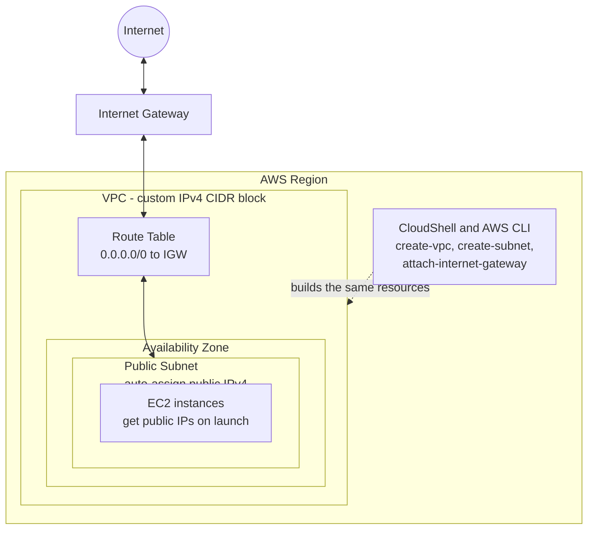
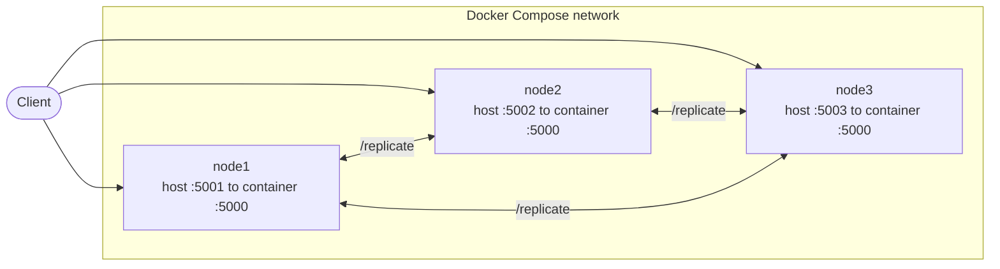
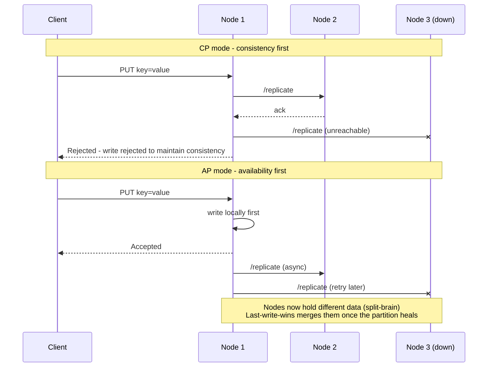
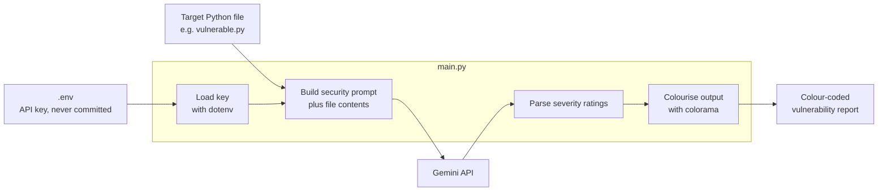

<p align="center">
  
</p>

# NextWork Projects

A collection of hands-on cloud, distributed systems and security projects, built by hand (not copy-pasted) to understand what each step is doing. Each project follows a [NextWork](https://nextwork.ai) guide and has its own README with notes, screenshots and lessons learned.

| Project | Focus | Stack | Details |
|---|---|---|---|
| [AWS VPC](./AWS_VPC) | Cloud networking | AWS VPC, Subnets, Internet Gateway, CloudShell/CLI | [README](./AWS_VPC/README.md) |
| [Breaking a Distributed System](./Breaking_distributed_sys) | CAP theorem, replication | Python, Flask, Docker, Docker Compose | [README](./Breaking_distributed_sys/README.md) |
| [AI Security Scanner](./Ai_Scanner_python) | Automated code review | Python, Gemini API, uv, colorama | [README](./Ai_Scanner_python/README.md) |

---

## 1. Build a Virtual Private Cloud

**What it is:** A VPC with a public subnet connected to the internet through an internet gateway, built first in the AWS console and then repeated with the AWS CLI in CloudShell.

**What I learned:** CIDR notation, how subnets must sit inside the VPC's range without overlapping, what makes a subnet "public" (a route to an internet gateway plus auto-assigned public IPv4), and where the CLI and console views can fall out of sync.



---

## 2. Break a Distributed System on Purpose

**What it is:** A three-node key-value store written in Flask and run with Docker Compose. I deliberately partition the cluster to watch the CAP trade-off happen, then add last-write-wins conflict resolution so diverged nodes can merge after the partition heals.

**What I learned:** CP vs AP behaviour in practice, why a CP cluster rejects writes during a partition, how AP mode leads to split-brain, and the trade-off of last-write-wins (valid but older data gets discarded).

### Cluster topology



### CP vs AP write behaviour during a partition



---

## 3. AI Security Scanner for Python

**What it is:** A Python script that sends source files to the Gemini API with a security-focused prompt, then prints a vulnerability report with colour-coded severity ratings. It was tested against a deliberately vulnerable file (`vulnerable.py`).

**What I learned:** Prompt engineering for structured output, working with an LLM API, keeping API keys out of source control with `.env` files, and parsing model output to colourise severity levels with colorama.

**Vulnerabilities found in the test file:** SQL injection, command injection, weak password hashing, and hard-coded credentials.



---

## Repo hygiene

Secrets are never committed. `.env`, credential exports and virtual environments are listed in `.gitignore`. To run the scanner yourself, create your own `.env` with a Gemini API key.

## Running the projects

```bash
# Distributed system
cd Breaking_distributed_sys
docker compose up --build

# AI scanner
cd Ai_Scanner_python
uv sync
uv run main.py
```

The AWS VPC project is built in the AWS console and CloudShell, so there is nothing to run locally.

## Author

Karan - built while working through [NextWork](https://nextwork.ai) projects.
